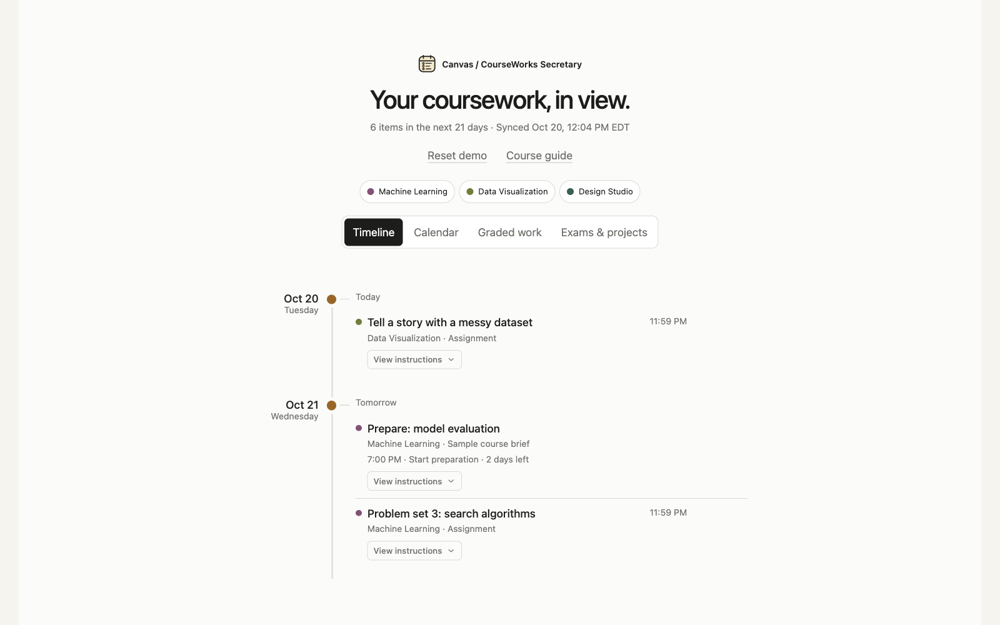

# Canvas / CourseWorks Secretary

**Your coursework, in view.**

A personal dashboard for deadlines and instructions scattered across course pages, announcements, and syllabi.

Canvas is the platform made by [Instructure](https://www.instructure.com/canvas). Schools may use a local name; Columbia calls its Canvas service [CourseWorks](https://courseworks.columbia.edu/about.html).



## What it does

- **Timeline and calendar:** see upcoming deadlines and preparation across your courses.
- **Graded work:** focus on work that counts toward your grade.
- **Exams and projects:** see confirmed major assessments grouped by course.
- **Course guide:** find essential grading, submission requirements, preparation, and rules distilled from the sources.
- **Source links:** open the original instructions when you need more detail.
- **Optional Aiken handoff:** send a task draft or coursework notes to Aiken for review.

The views share the same tasks. Linked coursework appears once, and known submissions leave the upcoming list. Preparation reminders stay separate from actual deadlines.

## Get started with ChatGPT

[Follow the short beginner guide](GET_STARTED.md): download the project, open its folder in ChatGPT Work, and copy the setup request. ChatGPT can guide the technical steps, subject to the tools and permissions available in your account.

Each installation belongs to one person. Course review happens in ChatGPT or another assistant; the website displays the approved guide alongside synced coursework.

For a course brief only, start with your materials in ChatGPT. For Sites, check the adaptation limits in [the beginner guide](GET_STARTED.md#what-about-sites). Commands and optional online hosting are in [the technical reference](TECHNICAL_SETUP.md).

## Keep your information private

- Keep access keys, course files, and personal guides out of GitHub. This project contains fictional demo data.
- Follow your school's Canvas access rules. Treat an access key like a password. [Access requirements](https://developerdocs.instructure.com/services/canvas/oauth2/file.oauth).
- Anyone with your dashboard password can see its coursework. Share it only with people who should have that access.

The app reads Canvas information. It does not submit work, edit Canvas, or mark tasks complete.

## How I used AI

I used Codex to build the app and study course sources, then distill the essentials into my private guide. The public project includes the application and review workflow so students can make their own version.

## Development

```sh
python -m pip install -e '.[test]'
python -m unittest discover -s tests
node --test tests/*.js
```

More: [demo](docs/demo.md), [course review](COURSE_GUIDE_UPDATE.md), [guide file format](PRIVATE_GUIDE_FORMAT.md).
