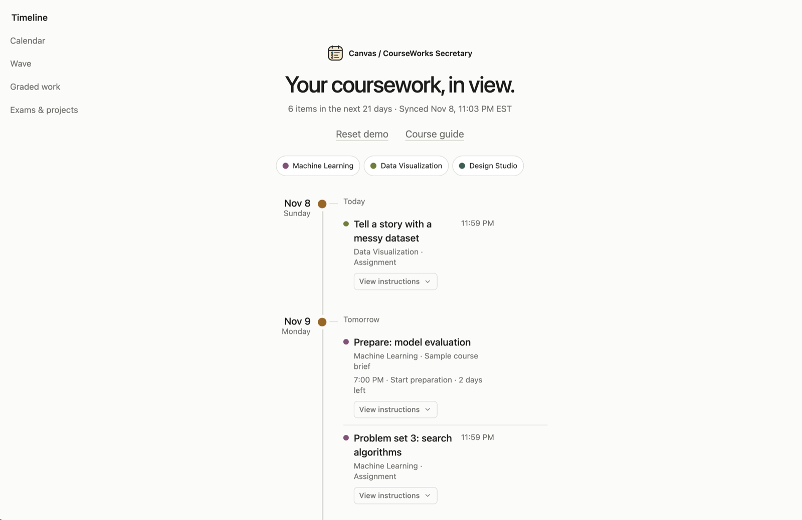

# Canvas / CourseWorks Secretary

**Your coursework, in view.**

A personal dashboard that pulls deadlines and instructions out of course pages, announcements, and syllabi, and puts them in one place.

Canvas is the course platform made by [Instructure](https://www.instructure.com/canvas). Schools may give it a local name; Columbia calls it [CourseWorks](https://courseworks.columbia.edu/about.html).



## What you get

Switch views from the menu in the top-left corner. Every view shows the same tasks, so a change in one shows up everywhere.

- **Timeline:** upcoming deadlines and class preparation, day by day. Work without a due date sits in its own list, and a **What changed** panel lists new or removed assignments, moved deadlines, and new announcements from recent refreshes until you mark them seen.
- **Calendar:** the same work by month. Pick a day to see its agenda.
- **Wave:** how heavy the coming weeks are. Each bar is the estimated hours of work due that day; the strip underneath shows the hours per day you'd need if you spread each task over the days before it's due. Zoom from one to eight weeks, show or hide late work, pick a day to see what's due, and change a task's size if the estimate feels wrong. Estimates come from your course guide, and tasks without one are marked as not estimated rather than guessed.
- **Graded work:** only what counts toward your grade, with a countdown to each deadline.
- **Exams & projects:** confirmed major assessments, grouped by course.
- **Course guide:** the essentials for each course (grading, what to submit, how to prepare, rules that matter), with links to the original sources.

You can also:

- **Mark work done** in Graded work when Canvas can't see it, such as something handed in on paper. Submissions Canvas does know about leave the list on their own.
- **Filter by course** with the chips under the title.
- **Send work to [Aiken](https://aikendewit.com/app/)** (optional). The **+** next to a task gives two choices: **New task in Aiken** opens a task draft with the course, deadline, and source link filled in; **Plan in Aiken Chat** copies a short message about the task and opens Aiken Chat for you to paste it. In Graded work you can select several tasks and send them in one message.

Preparation reminders stay separate from real deadlines, and linked coursework (for example, a quiz and the assignment behind it) appears once.

## Try it

[See the demo first](docs/demo.md): it runs on your computer with fictional courses and needs no Canvas account.

## Set it up for your courses

[Follow the beginner guide](GET_STARTED.md). In short: download the project, open the folder in ChatGPT Work (or another coding assistant), and paste the setup request. The assistant walks you through connecting Canvas and writing your course guide.

Commands and optional online hosting are in [the technical reference](TECHNICAL_SETUP.md).

## Keep your information private

- Keep access keys, course files, and your guide out of GitHub. This repository only contains fictional demo data.
- Follow your school's rules for Canvas access, and treat an access key like a password. [Canvas access requirements](https://developerdocs.instructure.com/services/canvas/oauth2/file.oauth).
- Anyone with your dashboard password can see your coursework. Share it only with people who should.

The app only reads from Canvas. It never submits work, edits Canvas, or marks anything complete there. Done marks and size changes stay in your browser.

## Development

```sh
python -m pip install -e '.[test]'
python -m unittest discover -s tests
node --test tests/*.js
```

More: [demo](docs/demo.md), [course review](COURSE_GUIDE_UPDATE.md), [guide file format](PRIVATE_GUIDE_FORMAT.md).
